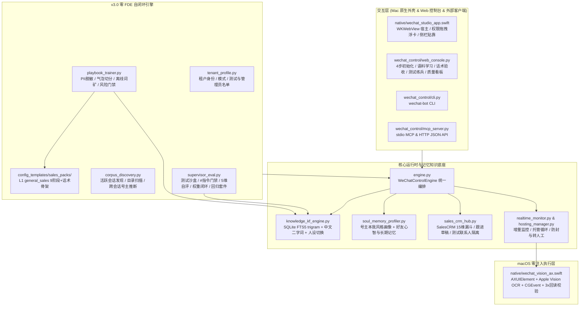
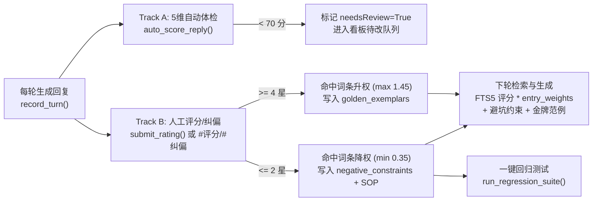

# WeChat Bot v3.0 开发者架构与升级文档

> **分支**：`feat/v3-zero-fde`（`/Volumes/SanDisk/WeChatBot`）  
> **目标**：从依赖 FDE（现场交付工程师）手动配置人设、录入知识库与调试脚本的 v2.9.2，升级为面向真实商业用户的 **v3.0 零 FDE 自助闭环系统**（4 步开箱初始化 → 业务语料自动发现与自学习 → 风险门禁审阅发布 → 测试小号 `#` 指令与双轨评分闭环 → 影子辅助平滑过渡到白名单托管）。

---

## 目录

1. [仓库与分支治理、构建与签名规范](#1-仓库与分支治理构建与签名规范)
2. [v3.0 整体架构与模块地图](#2-v30-整体架构与模块地图)
3. [核心子系统详细设计](#3-核心子系统详细设计)
   - [3.1 多租户身份与 L1/L2 销售策略包 (`tenant_profile` + `sales_packs`)](#31-多租户身份与-l1l2-销售策略包)
   - [3.2 零 FDE 语料发现与自训练流水线 (`corpus_discovery` + `playbook_trainer`)](#32-零-fde-语料发现与自训练流水线)
   - [3.3 测试小号沙盒隔离与 `#` 指令安全门禁 (`supervisor_eval`)](#33-测试小号沙盒隔离与--指令安全门禁)
   - [3.4 双轨评分、FTS5 权重闭环与回归套件 (`supervisor_eval` + `knowledge_kf_engine`)](#34-双轨评分fts5-权重闭环与回归套件)
4. [SQLite 存储 Schema 汇总](#4-sqlite-存储-schema-汇总)
5. [HTTP API、MCP 工具与 CLI 命令参考](#5-http-apimcp-工具与-cli-命令参考)
6. [测试与发布验收清单](#6-测试与发布验收清单)

---

## 1. 仓库与分支治理、构建与签名规范

### 1.1 仓库与分支演进
- **上游基线同步**：从 `draft-status` 工作区（`/Volumes/SanDisk/Builds/WeChatBot/draft-status.cUlVkiJS/source`，版本 `v2.9.2`）同步核心运行时代码、Swift 原生驱动、脚本与测试至 `/Volumes/SanDisk/WeChatBot` 的 `feat/v3-zero-fde` 分支（基准提交 `43776e6`，排除 `logs/`、`config/`、`config.bak-*`、`dist/`、`__pycache__/`、`*.pyc`、`.DS_Store`，并在 `.gitignore` 中忽略 `config/workbench/`）。
- **版本一致性约束**：`bin/build-standalone-app` 构建前强制校验 `APP_VERSION` 与 `pyproject.toml`、`plugin.manifest.json`、`dsh.plugin.json` 三处声明一致，防止 `.app` 与插件元数据错位。

### 1.2 干净客户构建 (`WECHAT_CLEAN_CUSTOMER_BUILD=1`)
开发态仓库包含开发调试默认数据与历史种子条目；交付给外部客户时必须执行干净客户构建：

```bash
cd /Volumes/SanDisk/WeChatBot
WECHAT_CLEAN_CUSTOMER_BUILD=1 ./bin/build-standalone-app
```

干净客户构建的关键行为：
1. 在打包后的 `.app/Contents/Resources/` 写入 `customer_build.marker`（`CUSTOMER_BUILD_MARKER = "customer_build.marker"`），**跳过写入开发机路径 `repo_root.txt`**，并额外打包 `config_templates/sales_packs/*.json` 与 `docs/*.md`（支撑软件内 `📖 使用手册`）。
2. `TenantProfileStore.is_customer_mode()` 检测到 `customer_build.marker` 即自动返回 `True`（默认 `mode="customer"`），`engine.py` 的 `_migrate_legacy_runtime_data` 自动跳过旧个人目录数据迁移，触发首次打开 4 步初始化向导。
3. 知识与人格底座完全去开发化：`knowledge_kf_engine.py` 以 `seed_mode="sales_pack"` / `withdraw_legacy_seeds()` 撤回所有 `seed-*` 内部种子并仅装载 L1 `general_sales.json`；`soul_memory_profiler.py` 在 `tenant_mode == "customer"` 时跳过任何个人默认别名兜底与硬编码联系人分支。
4. `.app` 运行时数据强制外置至 `~/Library/Application Support/WeChatBot/`（见 `wechat_control/engine.py`），绝不向 `.app/Contents/` 写入可变状态，既保护 macOS Sealed Resource 签名不被破坏，又确保版本覆盖安装（`ditto`）时用户配置、SQLite 库与日志完整留存。

### 1.3 本地叶证书签名与 macOS TCC 权限继承
- **Bundle ID 保持不变**：`WeChat Bot.app` 沿用 `com.openbot.wechat-bot`，原生二进制沿用 `com.openbot.wechat-studio-app` 与 `com.openbot.wechat-vision-ax`。
- **稳定指定需求 (`Designated Requirement`)**：`wechat_control/local_signing.py` 从 `~/Library/Application Support/WeChatBot/signing/local-signing.json` 读取受校验的本地叶证书指纹，使用：
  ```
  designated => identifier "<bundle_id>" and certificate leaf = H"<sha1>"
  ```
  进行 `codesign` 签名，避免 ad-hoc `cdhash` 每次重编变化导致 macOS TCC 重复失效弹窗。
- **安装后校验**：`bin/build-standalone-app` 安装至 `/Users/mac/Applications/WeChat Bot.app` 后自动执行 `local_signing verify`、`lsregister -f` 及 `wechat-studio-app --verify-headless`。

---

## 2. v3.0 整体架构与模块地图

### 2.1 分层架构图



### 2.2 核心模块职责速查

| 模块路径 | 核心类 / 职责 | 关键持久化位置 |
| :--- | :--- | :--- |
| `wechat_control/tenant_profile.py` | `TenantProfileStore`、`list_sales_packs`、`load_sales_pack`：管理租户身份、客户模式检测、管理员与测试好友名单及 L1 策略包加载。 | `config/tenant_profile.json` |
| `config_templates/sales_packs/general_sales.json` | L1 通用私域与顾问式销售策略包：9 阶段（`新线索` → `高风险转人工`）骨架与 16 条零技术黑话实战词条。 | 只读打包模板 |
| `wechat_control/corpus_discovery.py` | `CorpusDiscoveryEngine`：扫描微信活跃会话、过滤系统号与测试好友、扫描桌面/下载导出包、跨会话自动推断号主身份、批量导入标准化对话。 | 读取 `logs/contacts/` 与导入包 |
| `wechat_control/playbook_trainer.py` | `SelfTrainingPlaybookEngine`：PII 自动脱敏、30 分钟阈值多气泡 Q&A 归并、高价值回合筛选、离线 n-gram/PMI 词汇挖掘、L1×L2 话术合成、风险条款 `draft` 硬门禁。 | `logs/training_report.json` + 写入 KB |
| `wechat_control/supervisor_eval.py` | `SupervisorEvalEngine`：测试联系人沙盒、`#` 指令权限门禁与防外泄、5 类 `#` 指令闭环、5 维自动体检、1–5 星加权闭环、金牌范例、质量看板与回归套件。 | `config/supervisor_eval.sqlite` |
| `wechat_control/knowledge_kf_engine.py` | `WeChatKnowledgeStore`、`PersonaSwitchEngine`：SQLite FTS5 `trigram` 索引 + `split_search_terms` 中文 bigram 检索、性格/MBTI/互动风格切换。 | `config/wechat_knowledge.sqlite` |
| `wechat_control/soul_memory_profiler.py` | `SoulMemoryProfiler`：从聊天语料提取号主本我说话指标（句长、短句比、口头禅、标点习惯）与好友长期事实/事件记忆。 | `config/soul_memories.json` |
| `wechat_control/sales_crm_hub.py` | `WeChatSalesCRMHub`：15 维营销漏斗、BQ/BSP/BWS/PV 公式评估、北京时区提醒与 Top 1–3 跟进草稿（严格隔离测试好友）。 | `config/sales_crm.sqlite` |
| `wechat_control/realtime_monitor.py` | `WeChatRealtimeMonitor`：非侵入窗口快照巡检、未读气泡合并、转人工关键词检测、防自循环去重、结合 `supervisor_eval` `#` 指令与防外泄拦截。 | `logs/monitor_state.json`、`logs/monitor_events.jsonl` |
| `wechat_control/engine.py` | `WeChatControlEngine`：统筹各子系统、运行时数据迁移（`bundle` → `Application Support`）、安全发送（`ReadbackVerifier` 3x 熔断 + `OutgoingMessageRegistry` 120s 去重）。 | `config/` & `logs/` |
| `wechat_control/mcp_server.py` | stdio JSON-RPC 2.0 MCP Server + 多线程 HTTP API Server（含静态控制台渲染与接口鉴权）。 | `logs/console.pid` |
| `wechat_control/web_console.py` | 单页控制台 HTML/CSS/JS 渲染（含 4 步初始化向导、语料自训练、草稿审阅发布、模拟测试窗、质量看板与设置中心）。 | 无状态渲染 |
| `wechat_control/cli.py` | `wechat-bot` / `openbot-wechat` 统一命令行入口。 | — |

---

## 3. 核心子系统详细设计

### 3.1 多租户身份与 L1/L2 销售策略包

`TenantProfileStore`（`wechat_control/tenant_profile.py`）使用 `.io_utils.atomic_write_json` 保证配置写入原子性，Schema 为 `openbot.tenant-profile/1`：

- **双模式自动判定**：
  - 若 `bundle_root / "customer_build.marker"` 存在或已调用 `complete_onboarding(...)`，`is_customer_mode()` 返回 `True`（`mode = "customer"`）。
  - 开发仓库默认 `mode = "legacy"`，保障既有开发/个人工作流兼容。
- **核心字段**：
  - `ownerName` / `ownerAliases`：销售本人称呼与历史聊天别名（去重且经 `safety.normalize_chat_name` 归一化）。
  - `businessName` / `productSummary` / `industryPack`：企业与产品定位，默认策略包为 `general_sales`。
  - `onboardingCompleted`：控制首次打开是否弹出 4 步向导。
  - `adminContacts`（默认 `["文件传输助手"]`）与 `testContacts`（`add_test_contact` / `remove_test_contact` 管理）。
- **L1 通用策略包 (`config_templates/sales_packs/general_sales.json`)**：
  - 9 个销售阶段与 `sales_crm_hub.py` 对齐：`新线索`、`初步接触`、`沟通中`、`深入沟通`、`已报价`、`方案推进`、`已成交`、`暂缓`、`高风险转人工`。
  - 每阶段包含 `goal`、`strategy`、`keyActions`、`avoid`，附 16 条涵盖开场、诊断、异议（嫌贵/考虑一下/竞品/问老板/试用）、促单、唤醒、售后转人工及术语准则的 `script`/`faq`/`terminology`/`knowledge` 条目。

---

### 3.2 零 FDE 语料发现与自训练流水线

#### A. 语料发现与自动归属 (`wechat_control/corpus_discovery.py`)
1. **活跃会话智能发现 (`discover_wechat_sessions`)**：
   - 融合实时会话列表（`inspector_sessions`）与本地历史缓存（`histories_dir`）。
   - 自动过滤微信系统号/折叠账号（`公众号`、`服务号`、`微信团队`、`腾讯新闻`、`折叠` 等）以及 `test_contacts`（通过 `safety.normalize_chat_name` 归一化匹配）。
   - 按消息体量、最近活跃度与 17 个销售强信号关键词（`询价`、`报价`、`多少钱`、`预算`、`方案`、`合同`、`试用`、`下单`、`发货`、`交付`、`售后`、`优惠`、`对比`、`效果`、`合作`、`预约`、`买`）综合打分排序，输出带 `reasonTags` 与 `hasLocalHistory` 的推荐勾选清单。
2. **本地归档零破坏扫描 (`scan_archive_directories`)**：
   - 扫描 `~/Downloads` 与 `~/Desktop`（或指定目录）下的微信导出 `.zip` 与 `*聊天记录*.txt`，基于哈希/路径去重，只读返回元数据，绝不修改原文件。
3. **跨会话号主自动推断 (`infer_owner_from_bundles`)**：
   - 当提供 ≥ 2 份独立会话/导出包时，计算不同对话参与者的跨会话交集，自动锁定同时出现在多份会话中的销售本人（返回 `ownerName`、`confidence`、`method`、`candidates`）。
   - 单会话或无交集场景降级匹配 `known_aliases` 或高频回复方启发式推断。
4. **标准化双向对话导入 (`batch_import_archives`)**：
   - 调用 `bridge_importer.WeChatBridgeImporter` 解析 `.zip` / `.txt` / 目录，统一输出 `{contact, owner, records: [{direction: 'self'|'peer', sender, text, timestamp}]}`。

#### B. 话术自训练与风险门禁 (`wechat_control/playbook_trainer.py`)
1. **PII 自动脱敏 (`redact_pii`)**：
   - 复用密钥防护逻辑（`knowledge_kf_engine._guard_secrets`）并通过正则替换 11 位中国大陆手机号（`{手机号}`）、身份证号、银行卡号、邮箱（`{邮箱}`）、微信号（`{微信号}`）、详细街道门牌地址（`{地址}`）及已知客户姓名（`{客户}`），防止个案隐私跨客户泄露。
2. **多气泡回合切分 (`segment_qa_turns`)**：
   - 微信聊天常见“连发 3 条算一句话”，以 `gap_minutes=30` 为间隔阈值，将连续 `peer` 气泡合并为一条完整客户提问，将随后连续 `self` 气泡合并为销售回答，并挂接下一句 `next_peer_reply` 作为效果反馈信号。
3. **高价值回合筛选 (`select_high_value_turns`)**：
   - 剔除“在吗 / 好的 / 收到 / 嗯嗯 / 谢谢”等低信息量寒暄或被冷处理/拒绝的回合。
   - 按销售推进信号、客户积极追问、跨客户复用度与回答完整度打分并做相似意图聚类去重。
4. **100% 可离线词汇挖掘 (`mine_vocabulary`)**：
   - 使用中文 2–6 字 n-gram 统计、PMI 互信息、领域特异度（过滤通用停用词）与字母数字 SKU/型号正则提取行业黑话与产品词；`model_hub` 可用且 `use_llm=True` 时增强语义解释，离线环境则通过确定性上下文摘要兜底完成 `{term, aliases, definition, doSay, dontSay, evidence}` 构建。
5. **L1 × L2 策略合成与硬风险门禁 (`synthesize_playbooks`)**：
   - 将 L1 `general_sales.json` 阶段骨架 + 高分历史实战对话 + 行业词汇 + 号主本我风格指标（`avgSentenceLength`、称呼、口头禅）融合生成 L2 专属词条（`kind="script"|"faq"|"terminology"`）。
   - **硬风险门禁（Hard Risk Gating）**：任何命中具体价格/数字金额、折扣比例、退款退货条款、交付工期承诺、免费赠送或绝对化效果声称的条目，强制标记 `recommendedStatus="draft"`、`needsApproval=True` 与 `riskFlags=[...]`；仅无风险条目在 `auto_publish_safe=True` 时以 `source="self-train"`、`status="published"` 入库，其余必须经客户在界面通过 `approve_drafts` 核对编辑后方可发布，同步输出 `training_report.json`。

---

### 3.3 测试小号沙盒隔离与 `#` 指令安全门禁

由 `SupervisorEvalEngine`（`wechat_control/supervisor_eval.py`）与 `SalesCRMHub`、`CorpusDiscoveryEngine` 协同实现：

#### A. 测试联系人三层隔离
1. **业务学习隔离**：`CorpusDiscoveryEngine.discover_wechat_sessions` 自动剔除 `test_contacts`，防止模拟演练记录污染真实客户语料。
2. **CRM 漏斗隔离**：测试好友标记同步后，不进入对外生产客户商机金额、成交率与外呼待办统计。
3. **存储标记**：`supervisor_eval.sqlite` 的 `test_contacts` 表与 `tenant_profile.json` 的 `testContacts` 均通过 `safety.normalize_chat_name` 归一化匹配，避免群聊人数后缀 `(N)` 或全半角差异导致误判。

#### B. `#` 指令权限门禁与防泄露闭环
1. **严格鉴权 (`is_authorized_supervisor`)**：
   - **仅以下来源返回 `True`**：
     - 内部通道：`channel in ("workbench", "mobile", "sparring_sim")`
     - 已显式标记的测试好友：`is_test_contact(sender) == True`
     - 租户管理员名单或默认通道：`sender` 匹配 `admin_contacts` 或 `"文件传输助手"`
   - **普通外部微信客户一律返回 `False`**（`{"ok": False, "handled": False, "reason": "unauthorized_sender"}`），彻底杜绝外部客户通过发送 `#...` 注入规则或操纵知识库。
2. **出站防泄露拦截 (`is_hashtag_directive` / `is_blocked_outbound_directive`)**：
   - 同时识别半角 `#` 与全角 `＃` 开头指令。
   - 外发拦截守卫确保任何原始 `#...` 内部督导指令文本**永远不会被发送给外部普通客户**。
3. **5 类 `#` 指令解析 (`parse_hashtag_directive` & `handle_hashtag_directive`)**：

| 意图类别 | 典型输入示例 | 闭环动作 |
| :--- | :--- | :--- |
| `rate` | `#评分 2 语气太硬`、`#2分 没说交付周期`、`#5星 很好` | 关联该测试会话最新 `sparring_turns` 记录，更新人工星级与标签，触发关联词条权重的增/减与负向约束/金牌范例沉淀。 |
| `save_script` | `#话术 问价格 => 先了解需求数量再给区间`、`#记住 老客户统一9折` | 直接调用 `knowledge_store.save_entry(..., kind="script", source="supervisor-hashtag")` 发布/保存标准话术。 |
| `save_term` | `#词汇 定制版 => 指支持按logo和尺寸定制的方案` | 写入 `kind="terminology"` 专属行业词汇。 |
| `takeover_control` | `#接管`、`#停`、`#恢复` | 触发 `takeover_cb`，切换测试/托管会话为仅草稿或恢复自动回复。 |
| `critique_rewrite`（默认兜底） | `# 不能这样说，别一上来报底价，先问对方要几套`、`# 告诉他周五前下单送安装` | ① 读取最近一轮 `sparring_turns`；② 写入 `negative_constraints`（`bad_reply` + `rule_text`）；③ 衰减此前命中词条的 `entry_quality_stats.weight`；④ 写入修正 SOP 到知识库；⑤ 若传入 `reply_generator`，**立即按新约束重生成 `revisedReply`** 与确认回执 `ackMessage`。 |

---

### 3.4 双轨评分、FTS5 权重闭环与回归套件



1. **Track A — 5 维自动体检 (`auto_score_reply`)**：
   - `kbGrounding`：回复是否基于命中知识库事实依据。
   - `terminologyAlignment`：是否正确对齐专属行业词汇，避免禁用词。
   - `salesProgression`：是否推动对话向需求澄清或下一步推进，而非句号终结。
   - `complianceSafety`：是否触发高风险未授权承诺或命中 `negative_constraints`。
   - `humanLikeness`：直接复用 `coevolution_engine.evaluate_turn_human_likeness`（去列表枚举、去 AI 腔、去僵硬句号书名号、口语长度 6–145 字、上下文锚定）。
   - 汇总得出 `overallScore`（0–100）、映射 `stars`（1–5）、`needsReview`（`overallScore < 70`）及具体 `issues`。
2. **Track B — 1–5 星人工闭环与 FTS5 检索加权 (`submit_rating` / `get_entry_weights`)**：
   - 词条质量权重保存在 `entry_quality_stats.weight`，严格限制在区间 **`[0.35, 1.45]`**，避免单次异常评分彻底锁死或垄断词条。
   - 知识库检索（`knowledge_kf_engine` FTS5 `trigram` + `split_search_terms` 中文二字词匹配）结合 `get_entry_weights()` 对候选词条重排序；同时通过 `match_negative_constraints(query, limit=3)` 与 `match_golden_exemplars(query, limit=2)` 注入生成约束与少样本参考。
3. **质量看板与回归验证 (`get_quality_dashboard` / `run_regression_suite`)**：
   - `get_quality_dashboard(days=7)` 返回周期汇总指标、1–5 星分布、高频失分标签 Top 榜、低分待优化轮次、金牌范例与词条质量排行。
   - `run_regression_suite(reply_generator, limit=20)` 自动抽取历史上被 `#` 纠偏过或 `<= 2` 星的问题回合，重新经 `reply_generator` 与 `auto_score_reply` 验证是否避开负向约束并统计通过率。

---

## 4. SQLite 存储 Schema 汇总

### 4.1 督导评分与练兵闭环库 (`config/supervisor_eval.sqlite`)

```sql
CREATE TABLE IF NOT EXISTS test_contacts (
    contact_key TEXT PRIMARY KEY,
    display_name TEXT NOT NULL,
    note TEXT NOT NULL DEFAULT '',
    created_at TEXT NOT NULL
);

CREATE TABLE IF NOT EXISTS sparring_turns (
    id INTEGER PRIMARY KEY AUTOINCREMENT,
    contact_name TEXT NOT NULL,
    channel TEXT NOT NULL DEFAULT 'wechat',
    incoming_text TEXT NOT NULL,
    ai_reply TEXT NOT NULL,
    matched_entry_ids_json TEXT NOT NULL DEFAULT '[]',
    auto_score_json TEXT NOT NULL DEFAULT '{}',
    supervisor_rating INTEGER,
    supervisor_tags_json TEXT NOT NULL DEFAULT '[]',
    supervisor_comment TEXT NOT NULL DEFAULT '',
    hashtag_directive TEXT NOT NULL DEFAULT '',
    revised_reply TEXT NOT NULL DEFAULT '',
    created_at TEXT NOT NULL,
    updated_at TEXT NOT NULL
);
CREATE INDEX IF NOT EXISTS idx_sparring_turns_contact_id
    ON sparring_turns(contact_name, id DESC);
CREATE INDEX IF NOT EXISTS idx_sparring_turns_created
    ON sparring_turns(created_at DESC);

CREATE TABLE IF NOT EXISTS negative_constraints (
    id INTEGER PRIMARY KEY AUTOINCREMENT,
    trigger_text TEXT NOT NULL DEFAULT '',
    bad_reply TEXT NOT NULL DEFAULT '',
    rule_text TEXT NOT NULL,
    corrected_reply TEXT NOT NULL DEFAULT '',
    keywords_json TEXT NOT NULL DEFAULT '[]',
    source_contact TEXT NOT NULL DEFAULT '',
    active INTEGER NOT NULL DEFAULT 1,
    created_at TEXT NOT NULL
);

CREATE TABLE IF NOT EXISTS entry_quality_stats (
    entry_id TEXT PRIMARY KEY,
    rating_sum INTEGER NOT NULL DEFAULT 0,
    rating_count INTEGER NOT NULL DEFAULT 0,
    low_count INTEGER NOT NULL DEFAULT 0,
    high_count INTEGER NOT NULL DEFAULT 0,
    weight REAL NOT NULL DEFAULT 1.0,
    updated_at TEXT NOT NULL
);

CREATE TABLE IF NOT EXISTS golden_exemplars (
    id INTEGER PRIMARY KEY AUTOINCREMENT,
    trigger_text TEXT NOT NULL DEFAULT '',
    reply_text TEXT NOT NULL,
    stage TEXT NOT NULL DEFAULT '',
    rating INTEGER NOT NULL DEFAULT 5,
    keywords_json TEXT NOT NULL DEFAULT '[]',
    source_contact TEXT NOT NULL DEFAULT '',
    created_at TEXT NOT NULL
);
```

### 4.2 知识库与 FTS5 索引库 (`config/wechat_knowledge.sqlite`)

```sql
CREATE TABLE IF NOT EXISTS knowledge_entries (
  space_id TEXT NOT NULL,
  owner_bot_id TEXT NOT NULL,
  id TEXT NOT NULL,
  library TEXT NOT NULL,      -- 'shared' | 'bot'
  kind TEXT NOT NULL,         -- 'terminology' | 'knowledge' | 'script' | 'faq'
  title TEXT NOT NULL,
  body TEXT NOT NULL,
  keywords TEXT NOT NULL DEFAULT '[]',
  synonyms TEXT NOT NULL DEFAULT '[]',
  source TEXT NOT NULL DEFAULT '',
  external INTEGER NOT NULL DEFAULT 1,
  status TEXT NOT NULL DEFAULT 'published',  -- 'draft' | 'published'
  withdrawn INTEGER NOT NULL DEFAULT 0,
  revision INTEGER NOT NULL DEFAULT 1,
  created_at INTEGER NOT NULL,
  updated_at INTEGER NOT NULL,
  PRIMARY KEY (space_id, owner_bot_id, id)
);

CREATE TABLE IF NOT EXISTS knowledge_styles (
  space_id TEXT NOT NULL,
  bot_id TEXT NOT NULL,
  value TEXT NOT NULL,
  revision INTEGER NOT NULL,
  updated_at INTEGER NOT NULL,
  PRIMARY KEY (space_id, bot_id)
);

CREATE VIRTUAL TABLE IF NOT EXISTS knowledge_fts
  USING fts5(entry_rowid UNINDEXED, title, body, keywords, synonyms, tokenize = 'trigram');
```

### 4.3 SalesCRM 与待办草稿库
- **`config/sales_crm.sqlite`（`wechat_control/sales_crm_hub.py`）**：核心表包括 `crm_people`、`crm_accounts`、`crm_aliases`、`crm_timeline_events`、`crm_followup_drafts` 及上游兼容表 `people`、`contact_accounts`、`contact_aliases`、`contacts`、`conversations`、`messages`、`moment_interactions`、`events`、`failure_archives`。
- **`saved_draft` / `review`（`wechat_control/saved_drafts.py`、`wechat_control/workbench.py`）**：持久化「加入待办」草稿与审阅事件流。

---

## 5. HTTP API、MCP 工具与 CLI 命令参考

以下接口与命令均已合入 `feat/v3-zero-fde`（commit `2c8d4f1`）：

### 5.1 本地 HTTP API（`wechat-bot serve-http --port 18788`）

#### 基础运维与原有核心接口
| 分类 | 方法与路径 | 说明 |
| :--- | :--- | :--- |
| **系统与权限** | `GET /health`、`GET /api/overview`、`GET /api/diagnostics` | 健康检查、全局工作台聚合、深度排障诊断 |
| | `GET /api/permissions`、`POST /api/permissions/request`、`POST /api/permissions/repair` | 权限检查、系统弹窗请求与一键重新登记 |
| **对话与托管** | `GET /api/watch-contacts`、`POST /api/watch-contacts` | 关注/监视好友清单管理 |
| | `GET /api/hosting`、`POST /api/hosting` | 首页「一键托管」启停与状态查询 |
| | `POST /api/reply-preview`、`POST /api/takeover`、`POST /api/watch-once` | 智能草稿生成、人工接管/恢复、单轮实时巡检 |
| **知识库与语料** | `POST /api/kb-search`、`POST /api/kb-save`、`POST /api/kb-sync` | FTS5 知识库检索、保存与同步 |
| | `POST /api/import-chatlog-file`、`GET/POST /api/history-import` | 聊天记录归档与文档导入 |
| **模型与守护** | `GET /api/models`、`POST /api/model-select`、`POST /api/model-probe`、`POST /api/provider-save` | Magpie 网关及自定义 OpenAI 兼容供应商管理 |
| | `GET/POST /api/human-guard`、`POST /api/llm-gateway/relaunch` | 防抢鼠标守卫配置与网关拉起 |

#### v3.0 零 FDE 自闭环新增接口
| 方法 | 路径 | 对应 `WeChatControlEngine` Facade 方法 | 说明 |
| :--- | :--- | :--- | :--- |
| `GET` | `/api/onboarding/status` | `get_onboarding_status()` | 获取租户初始化状态、客户/传统模式、`salesPacks` 与 `testContacts` |
| `POST` | `/api/onboarding/setup` | `setup_tenant_onboarding(...)` | 完成 4 步初始化：写 `tenant_profile.json`、应用 L1 销售包、撤回旧种子、注册测试好友 |
| `GET` | `/api/sales-packs` | `list_sales_packs` | 列出内置行业销售策略包（`general_sales` 等） |
| `POST` | `/api/training/discover` | `discover_training_corpus(...)` | 发现高价值微信活跃会话与本地 `.zip`/`*聊天记录*.txt` 归档（过滤系统号与测试好友） |
| `POST` | `/api/training/run` | `run_self_training(...)` | 执行 PII 脱敏、气泡归并、词汇挖掘与风险门禁话术合成 |
| `POST` | `/api/training/approve` | `approve_training_drafts(...)` | 审核通过并发布待审核高风险草稿（支持 `edits` 改写） |
| `GET` | `/api/test-contacts` | `list_test_contacts()` | 列出全部内部测试好友 |
| `POST` | `/api/test-contacts` | `set_test_contact(...)` | 添加或移除测试好友（同步 `TenantProfileStore` 与 `SupervisorEvalEngine`） |
| `GET` | `/api/sparring/turns` | `list_sparring_turns(...)` | 查询模拟及测试好友对练历史轮次与评分 |
| `POST` | `/api/sparring/chat` | `sparring_simulate_turn(...)` | 在无需微信窗口下执行一轮模拟客户对话并附带 5D `autoScore` 与 `turnId` |
| `POST` | `/api/sparring/regression` | `run_sparring_regression(...)` | 针对历史 `#` 纠偏与 `<= 2` 星题执行一键回归验证 |
| `POST` | `/api/supervisor/directive` | `handle_supervisor_hashtag(...)` | 执行授权 `#` 督导指令（`critique_rewrite`/`rate`/`save_script`/`save_term`/`takeover_control`） |
| `POST` | `/api/supervisor/rate` | `submit_reply_rating(...)` | 提交 1–5 星评分、失分标签（`语气太硬`/`未答重点`/`缺少推进`/`术语不准`/`价格越权`）及改写建议 |
| `GET` | `/api/supervisor/dashboard` | `get_quality_dashboard(...)` | 获取 7 天/N 天质量看板指标、星级分布、高频标签与词条权重排行 |
| `GET` | `/api/docs/user-guide` | `get_user_guide_markdown()` | 读取并返回 `docs/USER_GUIDE.md` 供界面「📖 使用手册」模态框渲染 |

### 5.2 MCP 工具（`wechat-bot serve-mcp`）
- **原有核心工具**：`wechat_doctor`、`wechat_auth_status`、`wechat_status`、`wechat_inspect_live`、`wechat_list_sessions`、`wechat_read_messages`、`wechat_ocr`、`wechat_send_text`、`wechat_import_chatlog`、`wechat_bind_contact`、`wechat_kb_search`、`wechat_kb_save`、`wechat_persona_switch`、`wechat_reply_preview`、`wechat_watch_once`、`wechat_monitor_status`、`wechat_human_guard`、`wechat_takeover_contact`、`wechat_list_models`、`wechat_select_model`、`wechat_soul_profile`、`wechat_memory_add`、`wechat_salescrm_pipeline` 等。
- **v3.0 零 FDE 新增 13 个 MCP 工具**：
  - 初始化与策略包：`wechat_onboarding_status`、`wechat_onboarding_setup`、`wechat_sales_packs`
  - 语料自训练：`wechat_training_discover`、`wechat_training_run`、`wechat_training_approve`
  - 测试沙盒与模拟回归：`wechat_test_contact`、`wechat_sparring_chat`、`wechat_sparring_regression`
  - `#` 纠偏与质量闭环：`wechat_supervisor_directive`、`wechat_supervisor_rate`、`wechat_quality_dashboard`
  - 操作手册读取：`wechat_user_guide`

### 5.3 CLI 命令（`./bin/wechat-bot <subcommand>`）
- **基础运维与调试**：`doctor`、`request-permissions`、`auth-status`、`auth-grant`、`auth-revoke`、`status`、`sessions`、`inspect-live`、`messages`、`ocr`、`send`
- **知识库、人设与监控**：`kb-list`、`kb-search`、`kb-add`、`kb-sync`、`persona-list`、`persona-switch`、`reply-preview`（别名 `ask`）、`watch`、`monitor-status`、`takeover`、`resume-contact`、`human-guard`
- **导入、画像与 CRM**：`import-chatlog`、`soul-profile`、`memory-add`、`crm`、`call-brief`、`export-article`、`export-account`、`export-channels`
- **服务启动与构建集成**：`serve-mcp`、`serve-http`（别名 `console`）、`botstudio-bridge`、`launch-app`
- **v3.0 新增子命令**：
  - `train-playbook [--discover] [--archive PATH ...] [--contact NAME ...] [--owner NAME] [--pack ID] [--approve ENTRY_ID ...] [--use-llm] [--no-auto-publish]`
  - `test-contact [list|add|remove] [TARGET | --name NAME] [--note NOTE]`
  - `quality-dashboard [--days 7] [--regression] [--limit 20] [--rate-turn TURN_ID --stars 1..5 [--tag TAG ...] [--comment TEXT]]`

### 5.4 Web 控制台最终 UI 标识对照（`wechat_control/web_console.py`）
- **顶部操作栏**：`✨ 快速训练向导`（打开 4 步弹窗：`1 · 身份与行业包` → `2 · 发现聊天与资料` → `3 · 词汇与草稿验收` → `4 · 3 轮模拟试跑`）、`📖 使用手册`（加载 `/api/docs/user-guide`）、`⚙️ 设置`。
- **主导航标签**：`🧪 测试与评分`（`data-tab="sparring"`，`#tab-sparring`，内置模拟客户对练窗、1–5 星质量仪表盘 & 低分改进清单、测试好友管理 & 对练日志打分、以及顶部 `🧪 一键回归验证` 按钮）。
- **联系人 / 对话测试标记**：`🧪 设为测试好友` / `🧪 取消测试好友`（同时位于 `#tab-monitor` `.conversation-recipient` 与 `#tab-care` 联系人卡片）。
- **回复草稿区 (`#sendText`)**：输入 `#` / `＃` 开头内容自动呈现 `🛡️ 管理员指令模式：仅指导 AI 改写，不直接发给客户` + `立即按指令改写`；`#draftQualityFeedbackBar` 展示 5D `autoScore`、`1★`–`5★` 评分按钮、问题标签（`语气太硬`、`未答重点`、`缺少推进`、`术语不准`、`价格越权`）、`提交评分` 与 `✨ 一键存为 SOP`。

---

## 6. 测试与发布验收清单

### 6.1 自动化测试套件

```bash
cd /Volumes/SanDisk/WeChatBot

# 1. 租户配置与 L1 通用销售包
python3 -m unittest tests/test_38_tenant_profile_and_sales_pack.py -v

# 2. 语料自动发现、PII脱敏、离线词汇挖掘与风险门禁自训练
python3 -m unittest tests/test_38_self_training_pipeline.py -v

# 3. 测试小号沙盒、# 指令权限门禁、双轨评分与回归套件
python3 -m unittest tests/test_39_supervisor_hashtag_and_scoring.py -v

# 4. v3 端到端集成（客户模式隔离、训练审批、# 防外泄、HTTP/MCP/CLI 全接线）
python3 -m unittest tests/test_40_v3_integration.py -v

# 5. 一并回归全部 v3 新增套件（31 tests）与旧有兼容核验
python3 -m unittest \
  tests/test_38_tenant_profile_and_sales_pack.py \
  tests/test_38_self_training_pipeline.py \
  tests/test_39_supervisor_hashtag_and_scoring.py \
  tests/test_40_v3_integration.py -v
```

### 6.2 前端语法与构建交付核验
1. **客户构建校验**：执行 `WECHAT_CLEAN_CUSTOMER_BUILD=1 ./bin/build-standalone-app`，确认 `dist/WeChat Bot.app/Contents/Resources/customer_build.marker` 存在、`repo_root.txt` 未写入、且已打包 `config_templates/sales_packs/*.json` 与 `docs/*.md`；构建前可执行 `bash -n bin/build-standalone-app` 校验脚本语法。
2. **前端脚本语法校验**：对 `web_console.py` 渲染出的桌面端与移动端 `<script>` 块使用 JavaScriptCore（`jsc`）或 `node -c` 执行语法检查，确保零前端语法错误。
3. **签名与无头启动校验**：确认 `python3 -m wechat_control.local_signing verify --path "dist/WeChat Bot.app" --bundle-id "com.openbot.wechat-bot"` 与 `bin/wechat-studio-app --verify-headless` 通过。
4. **运行时诊断**：执行 `./bin/wechat-bot doctor` 核验本地叶证书、TCC 权限、端口状态与安全门锁。
5. **文档与禁用词校验**：确认 `docs/USER_GUIDE.md` 零内部工程术语泄漏（18 个禁用词扫描无命中），且页面标签、API 路由、MCP 工具与 CLI 参数与代码保持一致。
