# WeChat Bot 使用者操作手册

> **适用对象**：企业老板、销售负责人、一线销售顾问、私域运营人员  
> **阅读前提**：无需任何编程或技术背景，照着每一步的「**你要做什么 → 点哪里 → 屏幕会看到什么 → 完成标志**」即可在 10 分钟内完成安装、学习业务、测试练兵并安全上线。

---

## 目录

1. [3 分钟安装软件与开启 2 项 macOS 权限](#1-3-分钟安装软件与开启-2-项-macos-权限)
2. [首次打开：4 步初始化你的专属销售助手](#2-首次打开4-步初始化你的专属销售助手)
3. [让软件自己学你的业务（3 种方式 + 挑样本技巧）](#3-让软件自己学你的业务3-种方式--挑样本技巧)
4. [验收你的专属词汇表和话术库](#4-验收你的专属词汇表和话术库)
5. [用测试小号把 AI 练熟再上岗（含 `#` 指令速查表）](#5-用测试小号把-ai-练熟再上岗含--指令速查表)
6. [给 AI 回复打分与持续优化](#6-给-ai-回复打分与持续优化)
7. [从「影子辅助模式」平滑切换到「好友一键托管」](#7-从影子辅助模式平滑切换到好友一键托管)
8. [数据全本地隐私说明 & 10 大常见问题快速排查](#8-数据全本地隐私说明--10-大常见问题快速排查)

---

## 1. 3 分钟安装软件与开启 2 项 macOS 权限

WeChat Bot 通过模拟正常人工查看和输入来协助你回复微信消息，因此不需要破解微信，只需要获得苹果电脑系统的 **2 项基础授权**：**辅助功能** 与 **屏幕录制**。

### 1.1 安装软件到「应用程序」

- **你要做什么**：把下载好的 `WeChat Bot.app` 放到电脑的「应用程序」目录中，避免在临时下载目录或外接硬盘中直接运行。
- **点哪里**：
  1. 在「访达（Finder）」中打开你下载软件的文件夹（或安装包窗口）。
  2. 将 `WeChat Bot` 图标拖入左侧或右侧的 **「应用程序（Applications）」** 文件夹。
  3. 双击「应用程序」里的 **WeChat Bot** 启动软件（若系统首次提示“来自身份不明开发者”或“确认打开”，请打开苹果菜单 `` → **系统设置** → **隐私与安全性**，在底部点 **「仍要打开」**）。
- **屏幕会看到什么**：WeChat Bot 主窗口打开；顶部状态栏会提示「正在连接工作台」，随后若缺少系统权限，屏幕中央会自动弹出 **「需要授权以下权限才能正常使用 WeChat Bot」** 引导窗口。
- **完成标志**：你可以在苹果电脑的「应用程序」中看到 `WeChat Bot`，且能正常打开看到引导界面。

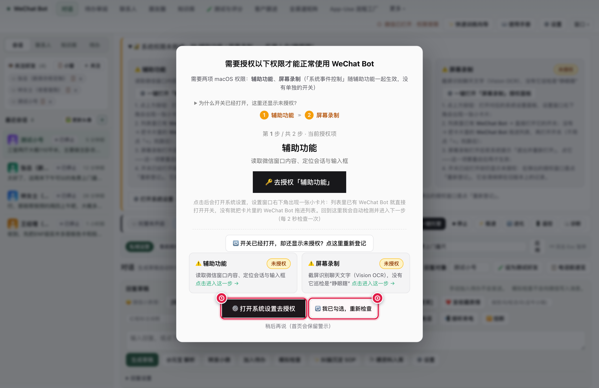
- **①「⚙️ 打开系统设置去授权」按钮**：自动跳转到系统设置的「辅助功能」或「屏幕录制」列表，并在设置窗口旁贴靠「WeChat Bot ⠿ 拖我」小浮卡。
- **②「🔄 我已勾选，重新检查」按钮**：在系统设置打开开关后点此按钮，立即变为绿色「已授权」并切换到下一项。

---

### 1.2 开启第 1 项权限：辅助功能

> **为什么需要它**？用来读取当前微信聊天窗口里的消息上下文，并在你确认发送或开启托管后，安全地把回复内容填入微信输入框。系统里的「系统事件控制」会随辅助功能一起生效，没有单独开关。

- **你要做什么**：在 macOS 系统设置中为 `WeChat Bot` 打开「辅助功能」开关。
- **点哪里**：
  1. 在弹出的授权引导窗口里，点击 **「⚙️ 打开系统设置去授权」**。
  2. 系统会自动跳转到 **系统设置 → 隐私与安全性 → 辅助功能**，同时屏幕上会出现一张贴靠在设置窗口旁的 **小浮卡**（上面写着 `WeChat Bot ⠿ 拖我`）。
  3. 如果列表里**已经有** `WeChat Bot`：直接把右侧开关拨成开启（蓝色/绿色）即可，可能需要输入一次电脑开机密码或指纹。
  4. 如果列表里**还没有** `WeChat Bot`：用鼠标按住小浮卡上的 **「WeChat Bot ⠿ 拖我」**，直接拖进系统设置的「辅助功能」应用列表里，再打开开关。
  5. 回到引导窗口或小浮卡，点击 **「🔄 我已勾选，重新检查」**（或 **「我已打开开关 → 完成并生效」**）。
- **屏幕会看到什么**：辅助功能状态变为绿色 **「✅ 已授权」**，小浮卡自动收起并自动切换到下一项未完成权限。
- **完成标志**：「辅助功能」显示为「已授权」。

---

### 1.3 开启第 2 项权限：屏幕录制

> **为什么需要它**？用来识别微信会话列表里的未读红点、聊天图片、公众号/视频号卡片和窗口画面内容。

- **你要做什么**：在 macOS 系统设置中为 `WeChat Bot` 打开「录屏与系统录音（屏幕录制）」开关，并按系统提示重启软件使其生效。
- **点哪里**：
  1. 点击授权弹窗中的 **「⚙️ 打开系统设置去授权」**，自动打开 **系统设置 → 隐私与安全性 → 录屏与系统录音**。
  2. 在列表中找到 `WeChat Bot` 并打开开关（若列表里没有，同样把小浮卡上的 **「WeChat Bot ⠿ 拖我」** 拖入列表后打开开关）。
  3. 当系统弹出提示框询问 **「“WeChat Bot”需要在退出并重新打开后才能录制屏幕内容」** 时，点击 **「退出并重新打开」**。
- **屏幕会看到什么**：软件自动重启一次，启动后权限引导弹窗不再出现，顶部连接状态变为绿色 **「工作台已就绪」**（或正常显示工作台主界面）。
- **完成标志**：两项权限均显示已授权，首页不再弹出红色/橙色权限警示。

> **💡 实用提示**：如果以前装过老版本、系统设置里开关明明开着却还提示未授权，请在授权弹窗上展开「为什么开关已经打开，这里还显示未授权？」，点击 **「重新登记授权」** 即可一键清理旧版本绑定记录并重新登记当前版本。

---

## 2. 首次打开：4 步初始化你的专属销售助手

第一次打开已授权的 WeChat Bot，软件会自动弹出 **「✨ 快速训练向导（4 步打造你的专属销售助手）」**（平时也可以随时在工作台顶部点击 **「✨ 快速训练向导」** 打开；顶部旁边的 **「📖 使用手册」** 按钮可随时在软件内翻看本手册）。

> **重要说明**：软件**开箱即用，无需任何额外安装配置**——不需要自己配代码环境、不需要额外装插件、也不需要手动写复杂规则，按向导顶部的 `1 · 身份与行业包` → `2 · 发现聊天与资料` → `3 · 词汇与草稿验收` → `4 · 3 轮模拟试跑` 填完即可使用。

### 第 1 步（`1 · 身份与行业包`）：填好身份、产品、场景与测试小号

- **你要做什么**：告诉 AI 你是谁、卖什么、用哪套销售策略模板，并可顺手指定测试小号。
- **点哪里**：在 **「1 · 身份与行业包」** 页面填写以下内容：
  1. **你的称呼 / 主账号名**：例如 `陈经理`、`小林`（AI 对话中需要自称时会使用这个称呼）。
  2. **企业 / 品牌名称**：例如 `星河定制家居`。
  3. **历史聊天里的常用名/别名（逗号分隔，帮助识别哪句是你说的）**：例如 `Kevin-华东区, 小陈`（有助于导入聊天记录时准确区分「哪句话是你说的、哪句话是客户说的」）。
  4. **一句话主营产品 / 业务简介**：例如 `主打全屋环保实木定制与上门量尺设计，主要服务新房装修业主`。
  5. **行业销售场景包**：下拉选择 **「通用私域与顾问式销售」**（默认推荐，内置 9 个私域跟进阶段与实战打底话术）。
  6. **测试好友名称（用于私下试跑与 # 指令调优）**（选填）：例如填入你的微信小号 `测试小号`，系统会自动将管理员默认包含为「文件传输助手」，普通外部客户绝无权通过 `#` 指令指挥 AI。
  7. 点击右下角 **「保存并进入第 2 步 →」**。
- **屏幕会看到什么**：第 1 步标签变为已完成状态，向导自动切换到第 2 步 **「2 · 发现聊天与资料」**。
- **完成标志**：进入第 2 步语料发现界面，专属身份与销售场景包已保存。

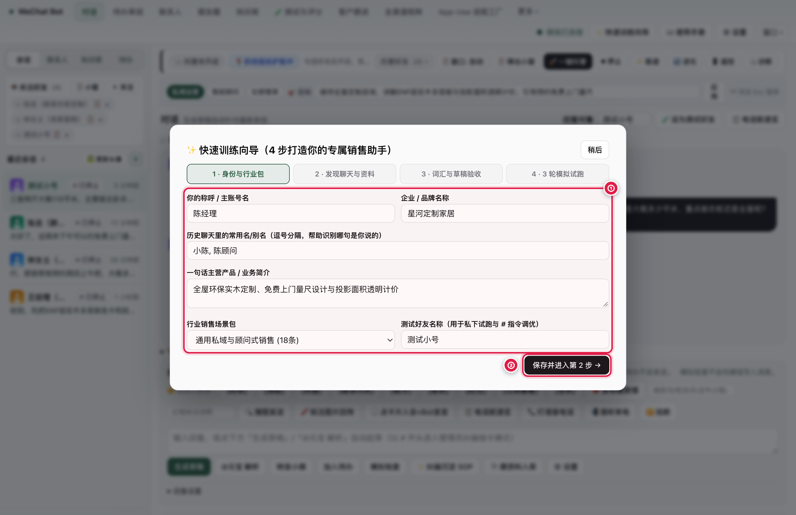
- **① 身份、产品与行业包表单区**：填写你的称呼、企业/品牌名称、历史聊天常用别名、业务简介、行业销售场景包及测试好友名称。
- **②「保存并进入第 2 步 →」按钮**：保存当前身份配置并自动切换到第 2 步发现聊天与资料。

---

## 3. 让软件自己学你的业务（3 种方式 + 挑样本技巧）

初始化到第 2 步 **「2 · 发现聊天与资料」** 后，你可以直接在这里让软件学习你的真实成交聊天记录和产品资料，随后也能随时在工作台补喂新资料。

> **💡 特别说明**：**无需安装额外 WeChatBridge 等第三方插件！** 本软件已经内置聊天导出包解析与微信窗口直接读取能力，所有导入与学习操作都在软件内一站完成。

### 方式 1：自动发现微信活跃客户并勾选学习（最省事）

- **你要做什么**：让软件扫描你当前微信里最近互动频繁、带有询价/方案/成交信号的好友会话，你只需打勾即可批量学习。
- **点哪里**：
  1. 先确保电脑上的 **微信** 处于登录状态。
  2. 在向导第 2 步 **「2 · 发现聊天与资料」** 中，点右上角 **「🔍 重新扫描会话与导出包」**（首次进入第 2 步也会自动扫描）。
  3. 查看左侧 **「活跃高价值微信会话」** 列表——软件已经自动过滤掉「公众号」「服务号」「微信团队」「腾讯新闻」及你设置的「测试好友」，把带有**询价、报价、方案、合同、交付、试用、对比**等高价值信号的客户排在前面并标出推荐理由。
  4. 勾选你想让 AI 学习的 3–10 位代表性老客户或高意向客户，点击 **「⚡ 开始自训练并提炼话术 →」**（如果暂不训练想先体验，可点「跳过训练直接看话术」）。
- **屏幕会看到什么**：系统自动提炼行业词汇表与话术草稿，完成后自动跳到第 3 步 **「3 · 词汇与草稿验收」** 并展示本次提炼统计。
- **完成标志**：第 3 步顶部显示本次生成的词汇条数与话术/草稿条数。

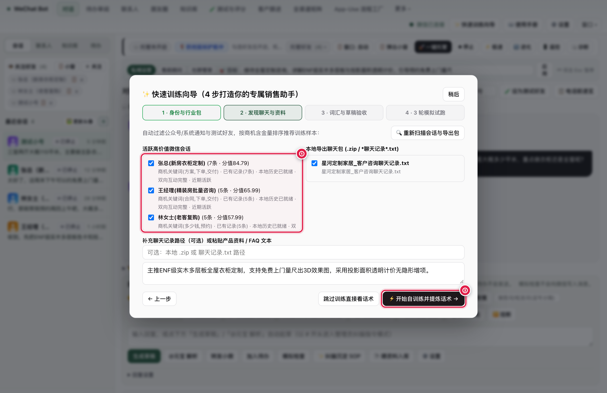
- **①「活跃高价值微信会话」勾选列表**：自动过滤公众号、服务号、系统通知与测试好友，按询价/方案/下单等商机信号排序，勾选 3–10 位老客户即可。
- **②「⚡ 开始自训练并提炼话术 →」按钮**：汇总勾选的微信会话、右侧本地导出聊天包以及下方粘贴的产品/FAQ 文本，一键提炼词汇表与话术草稿。

### 方式 2：拖入或扫描微信「合并转发」的聊天记录（效果最深）

- **你要做什么**：把微信里以前聊得特别好的金牌成交对话，导出或合并转发成文件让软件学习。
- **怎么从微信准备文件**：
  - 在手机或电脑微信里打开一位老客户的聊天窗口 → 长按/多选你们之间最精彩的一段咨询成交对话 → 点 **「合并转发」**（或用电脑微信聊天记录导出功能）保存为 `.zip` 压缩包或 `聊天记录.txt` 文件。
- **点哪里**：
  1. 在第 2 步右侧 **「本地导出聊天包 (.zip / *聊天记录*.txt)」** 列表中直接勾选扫描到的文件（系统会自动扫描你电脑的「下载」和「桌面」目录，绝不改动原文件），**或者**把本地文件路径填进下方 **「补充聊天记录路径（可选）或粘贴产品资料 / FAQ 文本」** 输入框中。
  2. 点击 **「⚡ 开始自训练并提炼话术 →」**（系统如果同时读取了 2 份以上不同会话，会自动对比交叉发言人猜出哪位是你自己，并结合你第 1 步填的别名合并识别）。
- **屏幕会看到什么**：系统自动把同一方连续发的碎气泡合并成完整的一问一答，自动遮蔽手机号、微信号、地址等隐私信息，并提炼出词汇表和话术草稿。
- **完成标志**：进入第 3 步看到提取出的行业词汇与待验收草稿列表。

### 方式 3：喂入产品资料、常见问答或价目表（补齐硬知识）

- **你要做什么**：把产品手册、规格参数表、报价说明、常见售后 FAQ 喂给 AI，避免它回答具体参数时瞎编。
- **点哪里**：
  - **在向导中快速喂入**：在第 2 步下方的文本框中直接粘贴产品介绍、常见问答或报价说明文本，点击 **「⚡ 开始自训练并提炼话术 →」** 一起提炼。
  - **日常随时补充文档**：在主工作台 **「对话」** 底部操作栏点 **「📄 喂资料入库」**（或进入 **「知识库」** 标签页），把 `.pdf`、`.md`、`.txt` 格式的产品文档直接拖进去或粘贴长文本；策略选择保持默认的 **「绑进知识库（推荐）」**，点击拆解入库。
- **屏幕会看到什么**：软件自动把长文档拆分成清晰的「核心卖点」「规格参数」「常见问题」「注意事项」卡片，供你核对后保存。
- **完成标志**：界面提示资料已拆解入库，在「知识库」标签页中可搜到对应产品条目的内容。

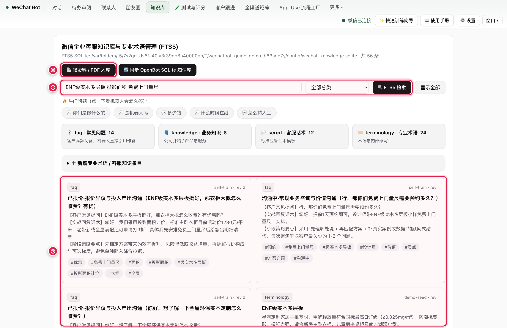
- **① 关键词检索与分类筛选栏**：输入产品词或问题关键词，按分类快速查找已入库话术与术语。
- **②「📄 喂资料 / PDF 入库」按钮**：随时补充产品手册、价目表或常见问答，自动拆解入库。
- **③ 已入库知识与术语卡片列表**：展示客户常见提问、实战回复话术、阶段策略要点与标签，支持随时修改。

### 附：如何挑选高质量样本（事半功倍的 4 条技巧）

1. **优先选「从陌生到成交」的完整对话**：包含客户质疑、你如何拆解价值、怎么回应预算问题、最后怎么收口下单的记录最值钱。
2. **宁缺毋滥，3–10 个好客户胜过 100 个闲聊群**：群聊水聊、纯“在吗/好的/谢谢/[表情]”会被系统自动过滤，但自己先挑出高质量私聊效果最好。
3. **补充「典型被拒与挽回」对话**：客户说“太贵了”“我再考虑一下”“问问合伙人”时你是怎么接住的，AI 学了这类样本最能提升成交率。
4. **隐私无需担心**：系统在学习前会自动把聊天里的手机号、邮箱、微信号、详细门牌地址和客户真实姓名替换为脱敏占位符，不会把张三的电话泄露给李四。

---

## 4. 验收你的专属词汇表和话术库

AI 从聊天记录和资料里学完后，**不会直接盲目对外部客户乱用涉及钱和承诺的内容**。在向导第 3 步 **「3 · 词汇与草稿验收」** 以及日常的 **「知识库」** 页面中，花 2 分钟做一次「出厂验收」。

### 4.1 核对与删改行业词汇表

- **你要做什么**：检查 AI 从你过往聊天中提炼出的行业黑话、产品简称、型号别称，确保它真的听得懂行话、说得出内行话。
- **点哪里**：
  1. 在向导第 3 步查看 **「提炼业务词汇表」** 展示的关键词标签；训练后也可随时在主工作台顶部进入 **「知识库」** 标签页，查看完整的词汇与话术列表。
  2. 对不准确的词条在知识库中点编辑修改定义或补充客户常说的同义词；没用的废词直接删掉或撤回。
- **屏幕会看到什么**：词汇标签与知识库卡片清晰列出词条名、解释与业务来源。
- **完成标志**：核心产品名、套餐名、行业缩写都准确无误，无莫名其妙的错别词。

### 4.2 重点核对「标红」的报价与承诺条款（安全门禁）

- **你要做什么**：逐条审批系统自动拦截成「待审核发布草稿」的高风险条目。
- **为什么会标红**？只要某条学出来的话术提到了**具体金额数字、折扣比例、退款/退货条件、具体几天交付、免费赠送权益、绝对化效果保证**，系统会强制设为 **「待审核草稿」**（带有风险标签提醒），必须由你亲自确认过才能上线，防止把给某个老客户的特批价当成公开统一报价发给所有人！
- **点哪里**：
  1. 在向导第 3 步的 **「待审核发布草稿（含价格/折扣/承诺等高风险条款，需勾选取舍后发布）」** 清单中逐条查看（也可在 **「知识库」** 中筛选草稿）。
  2. 核对标题和正文里的金额、折扣适用条件、交付周期是不是你的当前最新标准；需要微调前提条件的（例如“满 5 套才享 9 折”）直接在草稿框里改好字。
  3. 仅勾选确认无误的条目（确实不适合公开使用的取消勾选即可）。
- **屏幕会看到什么**：每张草稿卡片清楚标出触发的风险标签（如价格、折扣、交付承诺）与可编辑的标题/正文框。
- **完成标志**：已核对全部高风险草稿并勾选取舍完成。

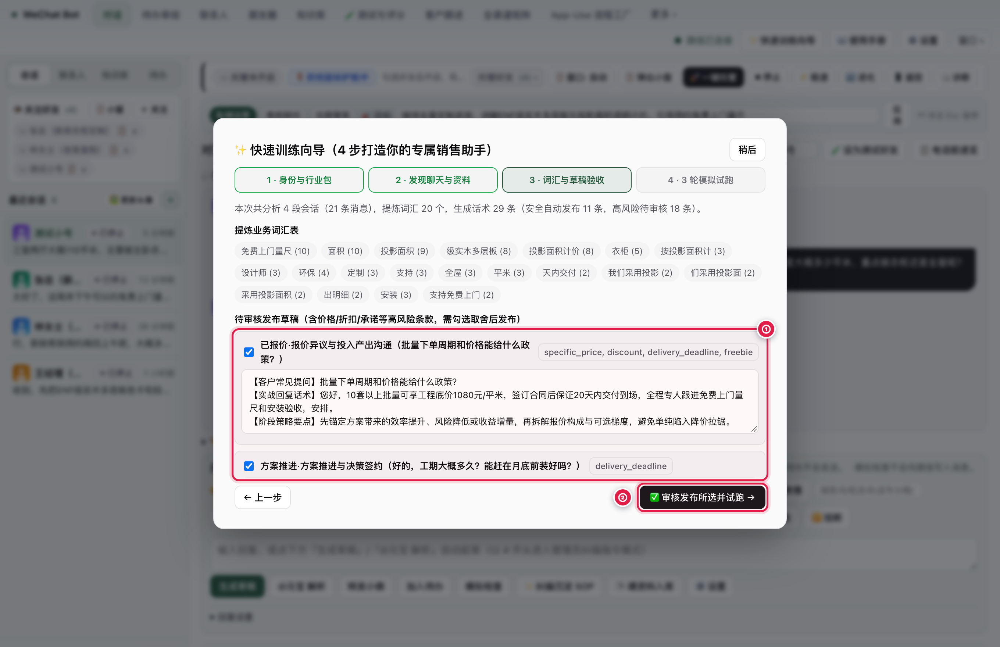
- **①「待审核发布草稿」门禁清单**：涉及具体价格、折扣、交付期限或免费承诺的条目都会被拦截在此，支持直接改字与勾选取舍。
- **②「✅ 审核发布所选并试跑 →」按钮**：确认勾选条款无误后一键发布上线，并自动进入第 4 步模拟试跑。

### 4.3 一键发布上线，并先做 3 轮模拟试跑

- **你要做什么**：把核对确认好的草稿正式发布进知识库，并在软件内先试聊 3 轮看效果。
- **点哪里**：
  1. 点击向导第 3 步右下角 **「✅ 审核发布所选并试跑 →」**，自动进入第 4 步 **「4 · 3 轮模拟试跑」**。
  2. 在第 4 步输入框里发几句客户常问的话（如“你们这套方案多少钱？”“能先看看案例吗？”），点击 **「发送测试」**。
  3. 满意后可点击 **「前往「🧪 测试与评分」工作区」** 继续深度练兵，或点击 **「🎉 完成初始化」** 回到主工作台。
- **屏幕会看到什么**：无需切到微信窗口，向导内立即展示 AI 结合新词汇与已发布话术生成的回复气泡。
- **完成标志**：第 4 步试跑回复符合你的业务口径，顺利进入主工作台或「🧪 测试与评分」工作区。

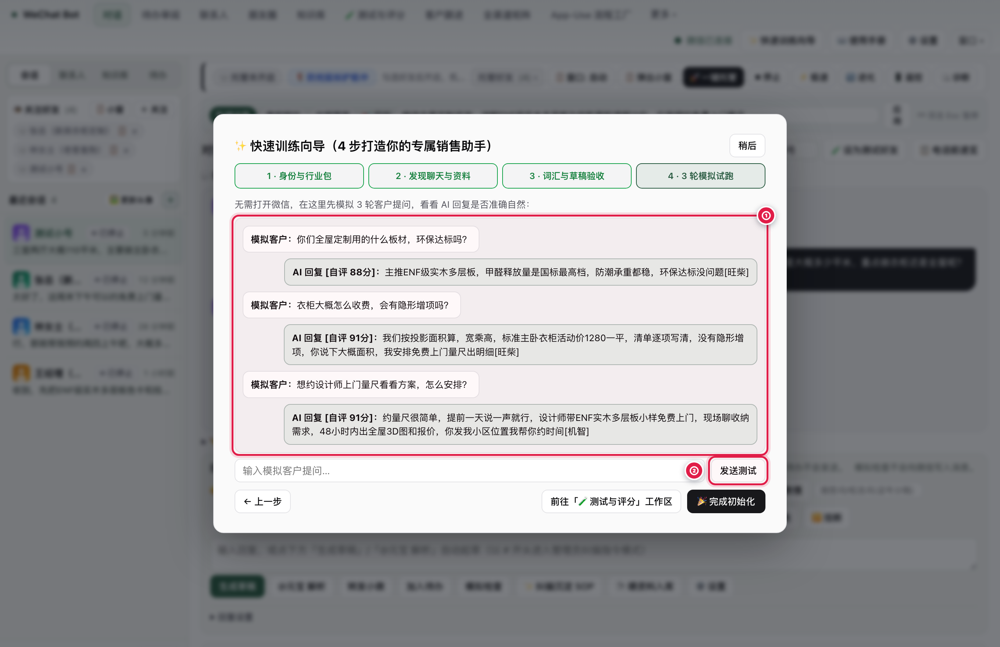
- **① 3 轮模拟试跑对话区**：无需打开微信即可连续模拟客户提问，实时查看 AI 回复口径与自动体检得分。
- **②「发送测试」按钮**：输入新问题即可追加试聊；确认满意后点击右下角「🎉 完成初始化」进入主工作台，或前往「🧪 测试与评分」工作区。

---

## 5. 用测试小号把 AI 练熟再上岗（含 `#` 指令速查表）

**千万不要一上来就拿真客户试水！** WeChat Bot 为你准备了零风险的「练兵沙盒」：你可以把自己的**微信小号 / 同事微信号**设为「🧪 测试好友」在真实微信里跟它对练，也可以直接在工作台顶部的 **「🧪 测试与评分」** 标签页内模拟买家连续发问，并用 `#` 井号随时当场纠偏。

### 5.1 准备工作：把小号或同事设为「🧪 测试好友」，或打开测试工作区

#### 方式 A：在真实微信里用测试小号对练
- **你要做什么**：把你用来测试的微信小号（或配合测试的同事）标记为「🧪 测试好友」。
- **点哪里**（以下 3 处任意一处均可设置）：
  1. **对话页顶部**：在 **「对话」** 页选中该好友后，点击回复对象栏右侧的 **「🧪 设为测试好友」**（需要取消时再点 **「🧪 取消测试好友」**）。
  2. **联系人页卡片**：进入 **「联系人」** 标签页，在对应好友卡片上点击 **「🧪 设为测试好友」**。
  3. **测试与评分工作区**：进入顶部 **「🧪 测试与评分」** 标签页，在底部的 **「3 · 测试好友管理 & 对练日志打分」** 右侧输入好友微信名，点击 **「＋ 添加测试好友」**。
- **屏幕会看到什么**：提示「已将『XX』设为测试好友（允许 # 指令纠偏，且不计入客户统计）」，该好友被添加到测试好友标签墙中，且**自动与正式客户跟进名单隔离**，不会污染真实客户的跟进记录与成交统计。
- **完成标志**：测试好友名单中已出现你的小号或同事名称。

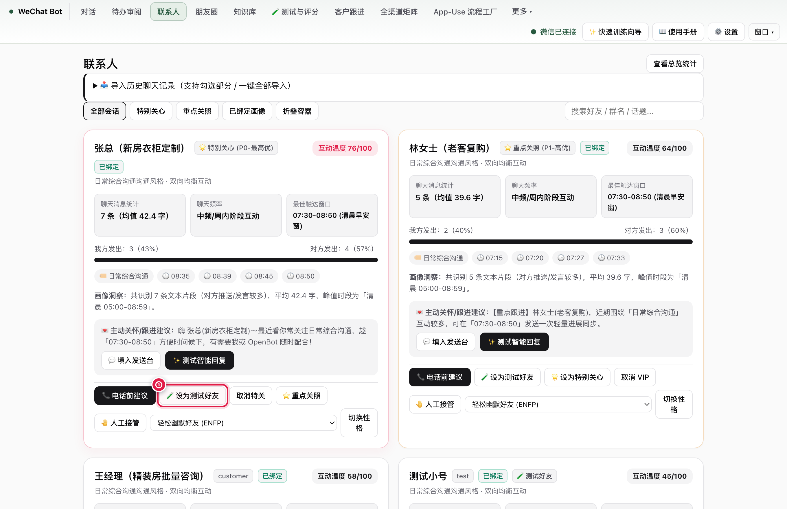
- **①「🧪 设为测试好友」按钮**：点击即可把该微信好友标记为内部对练测试小号，允许使用 `#` 指令纠偏，且数据与正式客户完全隔离。

#### 方式 B：直接在软件内的「🧪 测试与评分」模拟窗对练
- **你要做什么**：不想切来切去切换两个微信账号时，直接在 WeChat Bot 里面做本地零风险模拟压测。
- **点哪里**：点击主导航栏的 **「🧪 测试与评分」** 标签页，查看左侧 **「1 · 模拟客户对练窗口（本地零风险试跑）」**（可按需修改顶部的「测试好友/模拟客户名」与「模拟测试性格」下拉框）。
- **屏幕会看到什么**：界面左侧呈现双气泡对练窗口，输入提问后点 **「发送试跑」**（或直接按回车键），1–3 秒内就会收到 AI 的回答以及自动体检得分。
- **完成标志**：发送一句“你好，这个怎么卖”，模拟窗顺利回复并记录下本轮对话。

---

### 5.2 像真实买家一样连续发问，并用 `#` 当场纠偏

- **你要做什么**：扮演最挑剔的买家连续发问（例如：“直接报个最低价”“太贵了，别家才一半”“周五能不能发货”“我考虑考虑”）。当你发现 AI 哪句话说得不对、太硬或露馅时，**直接在下一条消息以 `#` 开头告诉它怎么改**！
- **点哪里**：
  - 在 **「🧪 测试好友」** 的微信聊天窗里直接发送 `#` 开头消息；
  - **或者**在 **「🧪 测试与评分 → 1 · 模拟客户对练窗口」** 里直接发送 `#` 开头消息；
  - **或者**在 **「对话」** 页的回复草稿框里直接输入 `#` 开头内容：输入框上方会自动弹出提示条 **「🛡️ 管理员指令模式：仅指导 AI 改写，不直接发给客户」**，点击提示条右侧的 **「立即按指令改写」** 即可。
- **安全门禁说明（非常重要）**：
  - **谁发才有效**：只有你在测试沙盒、手机遥控台、设为 **「🧪 测试好友」** 的微信号或 **「文件传输助手 / 管理员」** 发出的 `#` 才会被系统当成“老板教AI”的指令。
  - **外部普通客户发 `#` 会怎样**：如果真实客户聊天时发了一句 `#活动咨询#` 或 `#怎么买`，系统会**严格忽略其指令权限**，绝不会让客户篡改你的话术，同时系统也有外发防泄露保护，**绝不会把你的 `#` 内部纠偏指令文本误发给普通外部客户**。

#### 📋 可直接复制的 `#` 指令速查表（支持半角 `#` 和全角 `＃`）

| 你想做什么 | 直接复制并改写这句话发送 | 发送后 AI 会立刻做什么 |
| :--- | :--- | :--- |
| **直接指出说错了并要求重写（最常用）** | `# 不能这样说，别一上来就报底价，先问对方要几套以及使用场景` | 1. 记住这条禁止写法（负向避坑） 2. 降低刚才那条旧话术的权重 3. 把正确要求存入标准话术库 4. **当场按新口径重新回复刚才那道题！** |
| **补充临时新政策 / 促销口径** | `# 告诉他本周五前下单可免费送上门安装调试` | 立刻把这条规则加入约束与话术，并按新政策当场重新生成刚才的回复。 |
| **直接保存一条标准话术** | `#话术 问价格 => 先了解客户人数或采购规模，再给对应区间价` | 直接沉淀一条新的「场景 => 标准话术」到知识库并回执确认。 |
| **直接教它一个行业新词汇** | `#词汇 定制版 => 指支持按客户Logo和尺寸单独开模定制的方案，起订量20套` | 将该术语与解释写入专属词汇表，后续遇到同义词自动对齐。 |
| **给刚才这句回复直接打分** | `#评分 2 语气太像客服机器人，不够口语化`  （或 `#5星 这句接得很好` / `#2分 漏说交付周期`） | 记录 1–5 星评分并附上原因标签；低分自动降权避坑，高分沉淀为金牌范例。 |
| **紧急接管或恢复** | `#停` 或 `#接管`  恢复自动回复：`#恢复` | 立即暂停当前测试/托管会话（仅出草稿不自动发），或恢复自动回复。 |

- **屏幕会看到什么**：发出 `#` 指令后，测试窗口/微信测试群里会收到一条简短的确认回执，紧接着就是 **AI 当场按新要求重新回答一遍的结果**！
- **完成标志**：你看到 AI 当场重回的句子完全符合你的预期。

- **①「🛡️ 管理员指令模式」提示条**：输入框键入 `#` 开头内容时自动亮起，确保指令仅用于改写草稿而不发给客户，点击「立即按指令改写」即可当场重生成。
- **②「回复质量打分 & 沉淀 SOP」反馈条**：展示 5 维自动体检分，支持点击 `1★`–`5★` 评分与失分标签并提交，或直接点「✨ 一键存为 SOP」存为标准话术。

---

### 5.3 一键复测历史踩坑题（确认改完不复发）

- **你要做什么**：每次你用 `#` 提完意见或打完低分之后，检查一下 AI 是不是真的记住了、会不会顾此失彼。
- **点哪里**：在 **「🧪 测试与评分」** 标签页右上角点击 **「🧪 一键回归验证」**。
- **屏幕会看到什么**：系统自动把所有曾被你用 `#` 纠正过、或打过 1–2 星差评的历史提问重新跑一遍，逐题核查是否避开了禁止说法，并在模拟窗下方展示「复测通过率（例如 `18 / 20 题通过，通过率 90%`）」以及未通过项详情。
- **完成标志**：历史踩坑题复测通过率达到 **85%–90% 以上**，关键红线问题（乱报价、乱承诺）全部通过。

---

## 6. 给 AI 回复打分与持续优化

AI 正式辅助你接待客户后，不需要你懂任何复杂参数，只需要像带新员工一样给它的草稿或回复打星，系统会自动“越用越准”。

### 6.1 1–5 星人工打分与失分标签

- **你要做什么**：看到特别棒的回复给 4–5 星鼓励，看到不够满意的回复给 1–2 星并点一下错在哪里。
- **点哪里**（两处均可随时打分）：
  1. **在「对话」页草稿框下方**：每次点完「生成草稿」后，下方评分反馈条会显示本句的自动体检分，直接点击 **`1★` 到 `5★`** 按钮。
  2. **在「🧪 测试与评分 → 3 · 测试好友管理 & 对练日志打分」列表**：每条历史对练记录下方也带有 **`1★`–`5★`** 快捷评分按钮。
  3. 打完星后，若发现问题，顺手点选下方失分标签（**`语气太硬`**、**`未答重点`**、**`缺少推进`**、**`术语不准`**、**`价格越权`**），再点 **「提交评分」**。
  4. （如果你直接手动修改了草稿内容，也可以直接点旁边的 **「✨ 一键存为 SOP」**，把你的修改直接沉淀为标准话术。）
- **屏幕会看到什么**：
  - **打 4–5 星**：对应引用的话术在知识库里的排序权重自动提高，且这条问答会存入 **「🏆 金牌范例库」**，以后遇到类似问题优先参考。
  - **打 1–2 星**：对应旧话术自动降权，如果你写了改写建议或选了失分标签，会自动生成一条「避坑约束」和修正规则。
- **完成标志**：界面提示评分已记录，相关话术权重已自动更新。

### 6.2 查看「1-5 星质量仪表盘」，每周 3 分钟持续优化

- **你要做什么**：每周五花 3 分钟扫一眼质量看板，把本周暴露出的共性短板集中补齐。
- **点哪里**：进入 **「🧪 测试与评分」** 标签页，查看右侧 **「2 · 1-5 星质量仪表盘 & 低分改进清单」**（点击右上角 **「🔄 刷新数据」** 可拉取最新统计）。
- **屏幕会看到什么**：
  1. **核心指标卡**：近 7 天平均分、总对话轮次、5 维自动体检均分（系统会自动对每条回复从“知识库依据、术语对齐、销售推进、合规安全、像不像真人” 5 个维度体检，低于 70 分会自动标黄提醒复核）。
  2. **星级分布与高频问题标签**：一眼看出本周扣分最多的是「语气太硬」「未答重点」还是「缺少推进」。
  3. **低分 / 需关注改进项**：集中列出得分较低的对练/对话轮次，方便你直接针对性纠偏。
  4. **本周动作**：对低分项打低分或用 `#` 纠偏补齐话术 → 点击右上角 **「🧪 一键回归验证」** 确认通过，3 分钟收工。
- **完成标志**：低分待改清单清空，本周均分稳步上升。

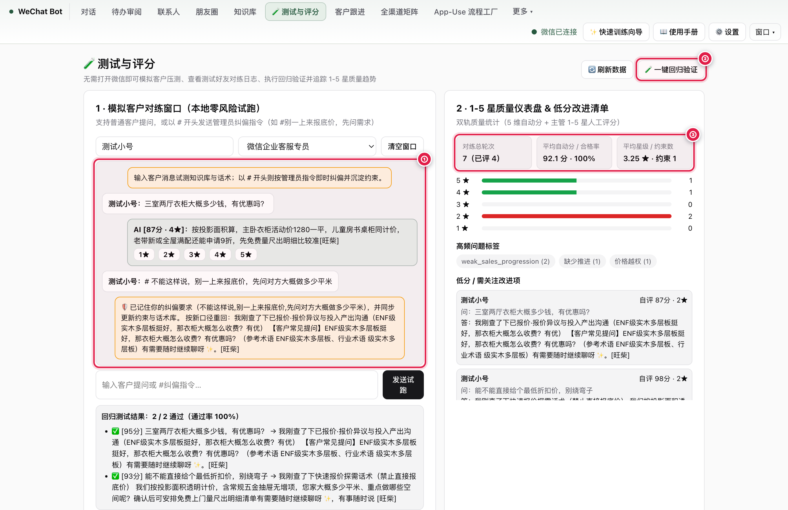
- **① 模拟客户对练窗口**：本地零风险连续模拟提问，发送 `#` 指令后立刻记住避坑约束并按新口径重新回答。
- **②「🧪 一键回归验证」按钮**：一键重跑所有历史纠偏和低分踩坑题，在下方展示通过率与逐题明细。
- **③ 1–5 星质量核心指标卡**：汇总对练总轮次、5 维自动体检均分/合格率与平均星级，下方列出高频问题标签与低分改进清单。

---

## 7. 从「影子辅助模式」平滑切换到「好友一键托管」

为了既保证零风险、又不耽误效率，强烈建议按 **「先影子辅助 → 再白名单托管」** 两步走。

### 7.1 第一阶段：影子辅助模式（只出草稿，不自动发送）

- **你要做什么**：让 AI 帮你在后台盯着最新来信并提前写好回复草稿，你扫一眼觉得没问题再自己点发送（最适合上线前 3 天）。
- **点哪里**：
  1. 在工作台 **「对话」** 首页左侧会话列表中，点击要处理的好友或把它加入 **「关注列表」**（此时**不要**点顶部的「🚀 一键托管」）。
  2. 右侧选择或核对对象后，点击下方 **「生成草稿」**；若遇到客户发来公众号文章、视频号或长链接，点 **「@元宝 解析」** 或 **「转发小微」**，系统会自动把解析结论写入草稿依据。
  3. 确认发送安全模式保持为 **「模拟检查（不写入微信）」** 或 **「粘贴校验后清空」** 进行试跑；确认草稿满意后，再切换为 **「确认并发送」** 发出。
- **屏幕会看到什么**：草稿框填入 AI 拟好的回复，下方可展开「草稿依据」查看它引用了哪几条知识库话术、当前用了哪种性格语气。你修改过的内容不会轻易被新草稿覆盖。
- **完成标志**：你连续确认了 10–20 条草稿，几乎不用大改就能直接发送。

### 7.2 第二阶段：开启「好友一键托管」（白名单自动回复）

- **你要做什么**：把已经磨合好的测试小号或成熟渠道的常规咨询好友，交由 AI 自动巡检并发送回复。
- **点哪里**：
  1. 在左侧 **「已关注 / 托管名单」** 中只保留你确认放心的联系人（**严格白名单机制**：不在名单里的好友或非白名单独立小窗，即使打开了也**只读不发**）。
  2. 点击顶部绿色主按钮 **「🚀 一键托管」**。
- **屏幕会看到什么**：顶部托管徽章变成绿色运行中状态，状态条显示「已关注监视 · 对方发消息将自动回复」。如果勾选了弹出独立小窗，多个托管对象可各自小窗并行不打架。
- **完成标志**：当白名单好友发来新消息时，系统自动完成草稿生成、安全校验并发送回复。

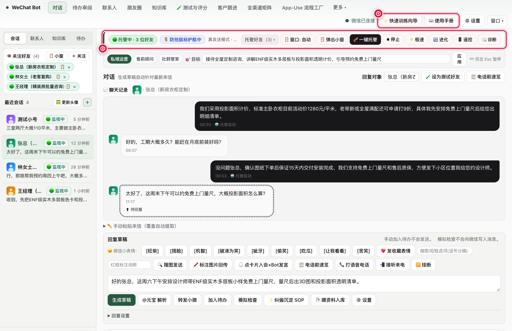
- **① 顶部「✨ 快速训练向导」与「📖 使用手册」入口**：随时可重新打开 4 步训练向导补充语料，或在软件内直接查阅本手册。
- **② 一键托管控制与安全护栏栏**：实时显示「托管中」好友数量、防抢鼠标护航状态、白名单列表与窗口模式，支持随时「⏹ 停止」或双击 `Esc` 急停。

### 7.3 安全防封节奏、双击 `Esc` 急停与随时转人工

系统内置了多层保护，既像真人一样自然，又让你随时能一把拉住刹车：

- **防封拟人节奏**：每次轮询自带随机间隔抖动（约 3–4 秒级不等，绝不死板定时），连续发来的多条碎气泡会自动合并后一次回复，发送前会进行「粘贴后回读长度与内容校验」，并阻止 120 秒内向同一人重复发送相同内容。
- **防抢鼠标守卫**：只要你自己在电脑上动了鼠标或敲了键盘，系统立即识别到“主人在用电脑”，**自动礼让暂停操作并进入 45 秒冷却保护**，绝不和你抢鼠标、绝不把消息贴到你正在打字的窗口里。
- **⌨️ 双击 `Esc` 急停**：无论你在工作台哪个页面，只要**连续按两次键盘左上角的 `Esc` 键**（或点击顶部 **「⏹ 停止」**），托管循环会**立即全局暂停**。
- **🙋 随时转人工**：
  - 客户在聊天里说出「转人工 / 找真人 / 人工客服」或触发退款、投诉、情绪激动等高风险词时，系统会自动将该客户标记为 **「人工接管中」**，后续只为你生成参考草稿，不再自动发送。
  - 你自己也可以在对话页或联系人页点 **「人工接管」**，或在微信里发 `#停`；等你处理完后，再点 **「恢复托管」**（或发 `#恢复`）即可。

---

## 8. 数据全本地隐私说明 & 10 大常见问题快速排查

### 8.1 数据全本地隐私说明

- **数据存在哪里**：你的所有客户档案、聊天记录缓存、知识库词条、行业话术、评分台账和训练报告，**全部保存在你这台 Mac 本机硬盘的用户目录中**（安装版固定存放在你个人账号的应用程序支持目录下，升级软件版本时历史数据会自动保留，不会丢失）。
- **会不会泄露给其他客户或外部公司**：
  1. 不同客户/测试好友之间严格隔离，「🧪 测试好友」的数据与内部 `#` 纠偏记录绝不会混入正式客户跟进列表。
  2. 导入聊天记录提取话术前，系统会自动对手机号、身份证号、银行卡、邮箱、微信号、详细地址和客户姓名做**自动脱敏替换**。
  3. 仅在你启用了智能回复模型服务并主动触发生成/深读时，才会将当前必要的单轮对话上下文发送给你自己选定的模型服务，其余所有资产与全量聊天历史均留在本机。

---

### 8.2 10 大常见问题快速排查

| 编号 | 常见现象 | 快速原因判断与解决步骤（照着点就行） |
| :--- | :--- | :--- |
| **1** | **系统设置里开关明明开着，软件还提示未授权？** | 多半是系统还记着旧版本的软件签名。打开授权弹窗 → 展开「为什么开关已经打开，这里还显示未授权？」→ 点 **「重新登记授权」** → 重新打开系统设置开关（屏幕录制需点“退出并重新打开”）。 |
| **2** | **点完屏幕录制开关后，软件还是认不出来微信画面？** | macOS 规定屏幕录制权限必须重启应用才生效。完全退出 `WeChat Bot`（快捷键 `Command + Q`）后再重新打开一次即可。 |
| **3** | **自动发现活跃客户时，列表里找不到刚刚聊过的人？** | 先把电脑版 **微信** 切换到「聊天」主列表并保持窗口可见（不要最小化到系统托盘或完全隐藏在其他桌面全屏空间里），然后回工作台点一次 **「🔄 刷新」** 再扫描。 |
| **4** | **拖入微信聊天记录后，系统把“客户说的话”当成了“我说的话”？** | 说明你在历史记录里的昵称和初始化填写的不一样。在导入确认页核对「销售本人名称」下拉框，改成聊天记录里属于你的那个名字，或回设置里把曾用昵称补充到「常用别名」后再重新导入。 |
| **5** | **AI 学完之后有几条带报价的话术找不到 / 没生效？** | 这是安全门禁在保护你！凡是提到具体价格、折扣、退款或交付天数的话术，都会自动放在待审核草稿里等待确认。点顶部 **「✨ 快速训练向导」** 进入第 3 步 **「3 · 词汇与草稿验收」**，或进入 **「知识库」** 筛选草稿，核对金额无误后勾选并发布即可生效。 |
| **6** | **我在测试小号微信里发 `#` 纠偏指令，为什么没反应？** | 请逐一检查 3 点：① 该小号是否已经设为 **「🧪 测试好友」** 或加入管理员名单（`文件传输助手` 默认可用）；② 消息是否以 `#` 或全角 `＃` 开头；③ 在此之前是否有至少一轮对话记录供系统定位“要改哪一句”。 |
| **7** | **如果真客户在微信里不小心发了 `#` 开头的消息，会不会把我的知识库改乱？** | **绝对不会！** 系统在执行任何 `#` 指令前都会做严格的身份核验，普通外部客户发 `#` 会被直接拦截忽略，且软件也禁止把原始 `#` 指令文本发往外部客户窗口。 |
| **8** | **一键托管跑着跑着突然自己暂停了，是不是坏了？** | 常见有两种正常保护触发：① **防抢鼠标守卫生效**——你刚才移动了鼠标或打了字，软件礼让暂停 45 秒后会自动恢复；② **触发转人工**——对方发了“转人工 / 退款 / 投诉”等字眼，或你连按了两次 `Esc` 急停。点工作台右上角 **「🩺 诊断」** 一眼就能看到具体原因。 |
| **9** | **导入的 PDF 产品手册识不出文字或有乱码？** | 纯图片扫描版 PDF 也能识别，请确认「屏幕录制」权限已开启，且不要把整本上百页的画册一次全塞进去；建议先挑核心产品页和价目页拆分后喂入，或直接复制文字粘贴到「📄 喂资料入库」里，拆解准确度最高。 |
| **10** | **担心 AI 回复太像机器人，怎么快速调教得更像我自己？** | 三招组合最快：① 在向导第 2 步导入你自己的 5 个真实成交聊天记录（让软件学你的句长、口头禅和标点习惯）；② 在 **「🧪 测试与评分」** 或测试小号里连聊 10 轮，遇到带“一二三点 / 您好请问”这种书面腔就发 `# 别用一二三点列清单，像微信口语一样分两句短话说`；③ 给口语自然的回复多打 **5★** 存成金牌范例。 |

---

## 9. AI 对话建流程与一句话改流程（不用写代码扩展飞书/钉钉/企微等新软件）

当客户或团队提出全新跨软件需求（例如：**从飞书 / 钉钉 / 企业微信 / 抖音 / 小红书私信提取客户微信号 -> 自报家门加微信并自动打上来源备注 -> 写入后端 CRM 档案**，或汇总待办写入文档）时，你**无需等程序员开发专用脚本**，也不用自己一次性想清所有细节——在工作台顶部的 **「App-Use 流程工厂 → 🧠 AI 场景自建与自动调试工坊」** 中，像平时微信聊天一样就能把新流程聊出来、调通并随时一句话微调。

### 9.1 对话式自建工作流（像聊天一样理清需求）

- **你要做什么**：只管先说一个模糊想法，AI 会通过 1–3 个简单的选择题帮你把来源软件、客户备注和安全确认门禁理清，然后自动生成并安全试跑。
- **点哪里**：进入 **「App-Use 流程工厂 → 💬 对话式自建工作流（像聊天一样理清需求）」**。
- **操作步骤**：
  1. **说出模糊想法**：在对话框输入例如 `帮我搞个飞书同步` 或 `帮我把钉钉客户提取微信号加微信` 并发送（也可直接点击上方快捷体验卡片）。
  2. **点选 AI 提出的小选择题**：AI 会按当前软件发出通俗选择题（比如“您想让钉钉同步做什么？”、“微信备注前缀打算用什么？”、“需要人工确认 + 发自报家门话术，还是仅影子模式自动试跑？”），直接点击选项按钮或打字回复。
  3. **一键确认并自动调试**：需求理清后，点击上方亮起的 **「✅ 确认并自动调试」**（或回复“确认开始调试”）。如需单句直出或切换实机模式，可展开下方的 **「⚡ 高级直出与验证参数」**。
- **屏幕会看到什么**：
  - 系统自动生成安全护栏与独立验收标准（拒绝“输入即成功”的自证），并在默认的 **Shadow 安全影子调试模式**下真实读取界面、验证抽取逻辑与分支，同时**自动拦截一切高风险外部发消息/加好友动作**。
  - 在右侧 **「🔁 逐轮自调试与补丁时间线」** 中，会直观展示结构化 **Shadow 预览卡片**（拟添加微信号、备注、打招呼话术、CRM 标签）以及可点击放大的**高清界面截图存证**。
  - 若某轮遇到控件漂移、等待不足或漏清零步骤，调试器会自动诊断根因、生成补丁版本并复跑验证；遇到登录扫码弹窗会立刻暂停交由人工；连续两次同因失败会自动停下并建议录制一次人工示范。

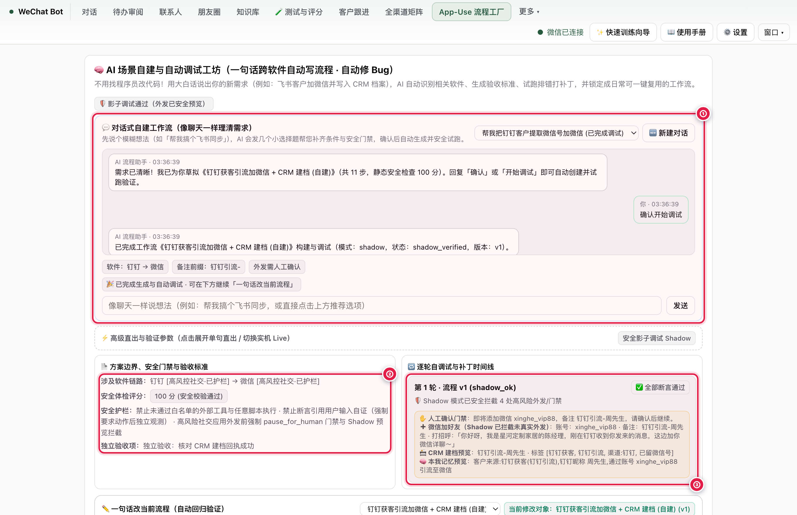
- **① 对话式自建工作流区**：像聊天一样提出跨软件需求，通过选择题确认软件链路（如钉钉 → 微信）、备注前缀与外发人工确认门禁后一键生成并试跑。
- **② 方案边界、安全门禁与验收标准**：自动列出跨软件护栏规则、100 分安全体检结果以及独立验收核对项。
- **③ 逐轮自调试与 Shadow 预览卡片**：在影子调试模式下安全拦截外发加好友动作，直观展示人工确认门禁、微信加好友打招呼预览、CRM 建档与记忆预览卡片。

### 9.2 一句话改当前流程（自动回归验证）

- **你要做什么**：流程建好后，想改备注前缀、加老客户跳过判断、给 CRM 加标签或改阶段、修改打招呼话术、重命名流程，或回退上一版，无需推倒重来。
- **点哪里**：在工坊下方的 **「✏️ 一句话改当前流程（自动回归验证）」** 右侧下拉框可直接切换要改的流程，再在输入框输入修改要求（或点快捷标签：`改备注前缀`、`加老客户跳过判断`、`给CRM加标签`、`改打招呼话术`、`加人工确认门禁`）。
- **常用改法举例**：
  - 改备注前缀：`把备注前缀改成 飞书大客户-`
  - 加分支跳过：`如果是老客户就跳过，不重复加好友` / `第3步之后加一个判断，如果微信号为空就跳过`
  - 给 CRM 加标签 / 改阶段：`给CRM加标签 高意向客户` / `把CRM阶段改成 深入沟通`
  - 改打招呼话术 / 重命名：`把打招呼语改成 你好呀，我是智拓巨浪的安晓心，这边加你微信发方案～` / `把当前流程重命名为 钉钉VIP获客`
  - 加安全门禁 / 改计算：`在加好友或发消息前加一步人工确认门禁` / `把计算表达式改成 25*4 并把断言改成 100`
  - 撤销刚才的修改：直接输入 `撤销上次修改` 或点击改动结果条中的 **「↩️ 撤销本次修改（回滚到 vN）」**
- **安全护栏与版本回滚**：每次修改都会自动备份旧版本（`v1 → v2`）、做安全体检评分并自动重跑回归验证；如果你要求删除最后一个验收校验或强制人工门禁，系统会**安全拦截并保留原版不破坏流程**。

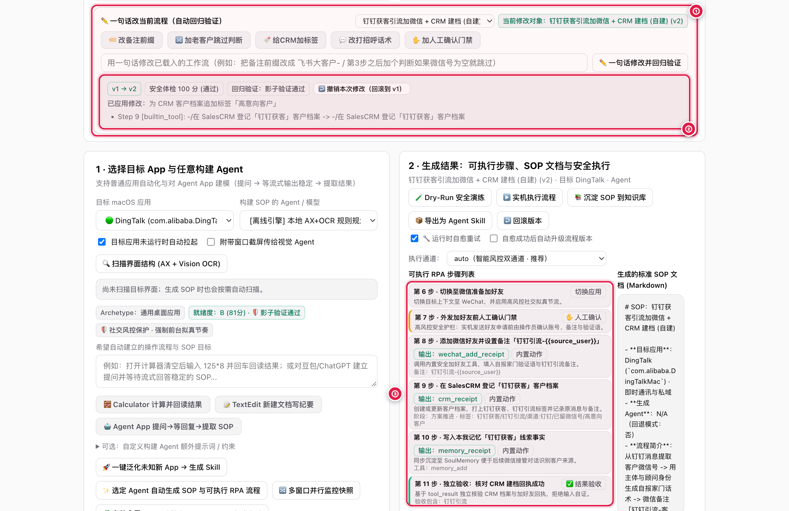
- **① 一句话改当前流程区**：切换目标流程后，可直接点击快捷标签或输入一句话修改并自动触发回归验证。
- **② 版本对比、改动明细与一键撤销条**：展示 `v1 → v2` 版本变化、安全体检与回归状态，支持点击「↩️ 撤销本次修改」多步回滚。
- **③ 可执行中文步骤卡片列表**：清晰呈现切换应用、人工确认门禁、内置动作与结果验收等中文步骤卡片。

### 9.3 在微信里直接发 `#建流程` / `#改流程` 遥控

除了在电脑工作台点选，你也可以在**设为「🧪 测试好友」的微信小号**或 **「文件传输助手 / 管理员」** 里发 `#` 指令直接多轮建流程、改流程：

| 你想做什么 | 直接发送这句话 | 发送后系统会做什么 |
| :--- | :--- | :--- |
| **微信里发起多轮建流程** | `#建流程 帮我搞个飞书同步` | 若细节不足会返回简明问题并记住上下文，接着直接发 `#建流程 备注用飞书多轮-，发前需要我确认` 即可续接完成生成与影子调试。 |
| **清空重开当前 `#建流程` 草稿** | `#建流程 重置` | 清除未完成的建流程草稿，重新发 `#建流程 你的需求` 即可开始新流程。 |
| **微信里一句话改现有流程** | `#改流程 把备注前缀改成 飞书大客户-` | 自动锁定当前工作流生成新版本、执行安全体检与回归验证，并回传改动摘要。 |
| **微信里撤销刚才的修改** | `#改流程 撤销` | 一键撤销上一版改动并恢复历史版本。 |
| **微信里加条件分支判断** | `#改流程 第3步之后加一个判断，如果微信号为空就跳过` | 在对应步骤后插入前向判断分支，保存新版本并复跑验收。 |

> **安全门禁提醒**：与所有 `#` 管理员指令一样，**只有你自己（管理员 / 文件传输助手 / 已标记的「🧪 测试好友」）发出的 `#建流程` 和 `#改流程` 才会被受理**；外部普通客户发来的任何 `#建流程` / `#改流程` 消息都会被严格拦截忽略，绝不会篡改你的自动化流程。

